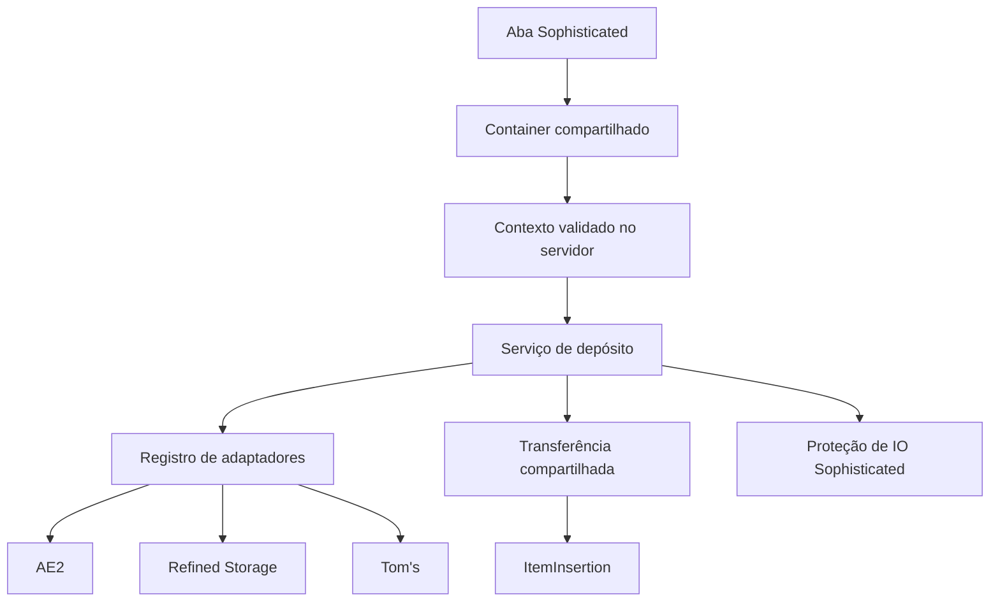

# Base de desenvolvimento dos upgrades

## Escopo

O projeto contém também o target Minecraft 26.1.2/NeoForge 26.1.2.124/Java 25, descrito no [porte](PORT_26_1_2.md). As evidências de teste e a aceitação manual são separadas (P12). As plataformas preservadas são Minecraft 1.21.1/NeoForge 21.1.236/Java 21 e Minecraft 1.20.1/Forge 47.4.10/Java 17. O mod se chama **Sophisticated Backpacks - Digital Storages Expansion**, com ID `sophisticated_backpacks_digital_storages_expansion` e pacote Java `com.radaeli.sophisticatedbackpacksdigitalstoragesexpansion`. Itens e receitas usam esse mesmo namespace. Os nove upgrades têm implementações específicas para os três targets. Forge compila e produz um JAR reobfuscado. A validação operacional em jogo é registrada por upgrade.

Os nove upgrades aparecem em uma aba criativa própria. A tooltip base do Sophisticated usa `item.<namespace>.<item>.tooltip`, com textos em inglês e português.

A hierarquia compartilhada das tooltips segue [P02](UPGRADES.md#P02): nome nativo → descrição em `GRAY` → status em `DARK_GRAY`, destacando somente o backend vinculado em `GREEN` → instrução de desvínculo em `DARK_GRAY`, somente se houver vínculo. `LinkedStorageUpgradeItem` preserva as linhas traduzidas pelo Sophisticated e aplica essa apresentação aos oito itens em EN-US/PT-BR. `StorageText.tooltipSummary` estiliza o resumo do item; o resumo das abas permanece independente. Pump acrescenta seu aviso de fluido pendente ao status por `getLinkStatus`, antes da instrução. Endereço avançado usa `DARK_GRAY`; nenhuma rede é resolvida para montar a tooltip.

Cada função tem seu próprio item universal, configurado manualmente para um endpoint de AE2, Refined Storage ou Tom’s. Os serviços cobrem inserção, extração, pickup, magnetismo, reposição, alimentação, alquimia e bombeamento de fluidos AE2/RS. Tom’s continua sem capacidade de fluidos.

## Estrutura multiloader

No Forge, a configuração Mixin declara explicitamente o refmap gerado para resolver o accessor de `ItemEntity.pickupDelay` em produção (`f_31986_:I`). MixinExtras Forge 0.4.1 acompanha o JAR por Jar-in-Jar para o `PickupContextMixin`, sem depender de outro mod que forneça a biblioteca. O gate `verifyForgeProductionJar` inspeciona o artefato de `reobfJar`; `testForgeProductionJarVerification` exercita arquivos danificados com o mesmo verificador. Esses gates pertencem a `check` e não substituem gameplay, conforme P01/P12 e [MULTILOADER.md](MULTILOADER.md).

A raiz coordena `common` e builds independentes em `targets/1.20.1/forge`, `targets/1.21.1/neoforge` e `targets/26.1.2/neoforge`. `common` tem Java 17 sem dependências de Minecraft e suas fontes são incorporadas nos três artefatos. O código com tipos Minecraft é compilado separadamente no loader correspondente; não existe binário de Minecraft compartilhado entre versões. O estado e os limites de validação do Forge estão em [MULTILOADER.md](MULTILOADER.md).

## Responsabilidades

| Parte | Responsabilidade |
| --- | --- |
| `LinkedStorageUpgradeItem` | Item Sophisticated, limite por storage, dica de vínculo e tooltip. |
| `EndpointLinkHandler` | Interação de vínculo para itens que implementam `ManuallyLinkedUpgrade`. Mantém o vínculo anterior quando o novo destino falha. |
| `LinkedStorageUpgradeWrapper` | Leitura, escrita, remoção e salvamento do vínculo pelo ciclo de vida nativo do Sophisticated. Expõe o filtro transitório de proteção de IO. |
| `LinkedStorageUpgradeContainer` | Validação dos pedidos no servidor, desvínculo, verificação de habilitação e limite de uma operação por tick do container. |
| `UpgradeOperationContext` | Origem e inventário obtidos do menu atual, após validar container, aba, validade do menu e wrapper instalado. |
| `LinkedStorageUpgradeTab` | Controles de vínculo e descrição da rede, atualizada quando o wrapper sincroniza. |
| `StorageAdapter` | Identificação e resolução de um backend opcional. |
| `StorageAdapterRegistry` | Registro dos adaptadores instalados e checagens comuns de dimensão, chunk e proteção. |
| `StorageConnection` | Resultado explícito da tentativa de acesso; diferencia vínculo ausente, mod ausente, dimensão indisponível, chunk descarregado, endpoint removido e acesso recusado. |
| `StorageTarget` | Endpoint resolvido para uma operação, com conectividade nativa, consulta de itens e inserção. |
| `StorageOperation` / `StoredItemAmount` | Autorização independente de inserção/extração e identidades com contagens `long`. |
| `FluidStorageTarget` / adaptadores | Contrato opcional de fluidos, consulta/simulação/extração/inserção em mB para AE2 e RS. |
| `ItemInsertion` | Destino de inserção associado ao jogador da operação, independente de menus e de classes dos backends. |
| `ItemTransferService` | Transferência com filtro, simulação limitada à origem, inserção real, recuperação de sobra e contagem do resultado. |
| `StorageTransferGuard` / `TransferInputFilter` | Bloqueio temporário de entrada externa na origem através de `IIOFilterUpgrade`, evitando que a rede deposite de volta na mesma mochila. |
| `DepositService` | Orquestração específica do depósito, reutilizando `DepositFilterLogic` e os serviços comuns. |
| `RestockService` / `UpgradeItemSources` | Extração de rede e mochila, com retorno de sobras; a segunda baseia-se em identidades e quantidades consultadas a cada operação. |
| Serviços Pickup/Magnet/Refill/Feeding/Alchemy | Roteamento por prioridade; automações de portador revalidam wrapper instalado/habilitado. Magnet também aceita o tick colocado com jogador elegível próximo e aplica a exceção nativa `AllowMachineRemoteMovement`; Refill `ANY` completa pilhas compatíveis antes de ocupar slots vazios. Feeding e Alchemy guardam consumíveis em reservas do item. |
| `PumpService` / `PumpReservation` | Contexto do portador ou jogador próximo à mochila colocada, alvos nativos e reserva persistida de até 1.000 mB; recupera reservas pendentes mesmo com Pump desativado e não inicia novas transferências nesse estado; Tom’s pausa a função. |
| `PumpStorageRouter` / `PumpTransferService` | Prioridade por operação, complemento parcial entre rede/tanque, seleção por fluido/componentes, simulação e recuperação. |
| `StorageTransferGuard` / `FluidTransferGuard` / `GuardedFluidHandler` | Escopos aninháveis de proteção de entrada/saída; o Mixin envolve a capability externa e verifica o bloqueio em cada chamada, inclusive em referências já em cache. |

## Ciclo de vida e segurança da operação

O wrapper persiste apenas backend, dimensão e posição. A aba e o item podem ler esses dados sem resolver uma rede ou carregar classes de um backend opcional. Objetos de jogador, bloco, rede e inventário não são salvos no item.

Cada pedido usa o container efetivamente aberto em `player.containerMenu`. A validação compara a identidade do container e do wrapper instalado, e consulta `getOpenContainer()`. O campo `UpgradeContainerBase.isOpen()` não é a autoridade: ele pode estar desatualizado imediatamente após instalar um upgrade. O mesmo guard protege alterações de filtro e ações.

O cliente envia somente o nome da ação pelo protocolo do Sophisticated. Origem, jogador, endpoint persistido e inventário são obtidos no servidor. Pedidos de um container removido, de uma aba fechada ou de um menu inválido são ignorados. As operações de transferência respeitam o estado habilitado do upgrade.

`StorageTarget` é transitório. Não armazená-lo em campos de wrappers ou containers: uma rede pode perder energia, mudar de topologia ou desaparecer. Cada operação passa novamente por `StorageAdapterRegistry.connect`. As verificações comuns consultam o mundo do endpoint e não carregam chunks.

### Descoberta de vínculo AE2

P02/P03/P04/P11: nos três targets, o evento de vínculo fornece o hit exato e a origem do jogador a StorageAdapterRegistry. O método padrão de StorageAdapter mantém compatibilidade com adaptadores que não precisam do hit ou da origem. Ae2StorageAdapter resolve o nó de controllers e outros blocos por IActionHost/IInWorldGridNodeHost e seleciona a peça de terminais por IPartHost.selectPartWorld. A peça central (cabo), fachadas, hits vazios e nós inativos são recusados.

Para novos pontos de clique, a rede deve estar energizada. Percorrer seus nós somente nessa interação e escolher um Wireless Access Point ativo, carregado, na mesma dimensão e com cobertura do jogador; preferir o mais próximo e desempatar pela posição. O vínculo salvo continua apontando para esse access point. Resolve, alcance, fonte de ação, acesso a itens/fluidos, reservas e persistência não mudam; vínculos antigos continuam válidos e não há redescoberta automática. A proteção do bloco clicado e do endpoint salvo permanece server-side.

Aceitação P12: conferir em jogo controllers, terminais multipart, outros dispositivos, cabo ao lado do terminal, dispositivo offline, rede sem access point, múltiplos access points, troca/remoção e perda de cobertura nos três targets. Verificação em 2026-11-13: os três builds e verificadores dos JARs de produção passaram. Forge executou 1 teste JUnit, 16 GameTests e os gates de empacotamento; NeoForge 1.21.1 executou 72 testes principais e 5 do perfil SCC; 26.1.2 executou 84 testes JUnit no perfil none e seus GameTests mínimos. O perfil AE2 de 26.1.2 passou os 21 cenários do addon, incluindo a regressão nativa de descoberta e o evento dos nove itens. A lógica do adaptador AE2 é idêntica nos três targets, exceto pelo import de IItemHandler do loader. Esses resultados não substituem a aceitação manual nos três targets. O portal passou em check/build.

### Descoberta de vínculo RS e SCC

P02/P03/P04/P09/P11: RefinedStorageAdapter preserva o endpoint controller. No Forge, dispositivos INetworkNodeProxy ativos resolvem INetwork.getPosition, com rede canRun e controller carregado da mesma rede. No NeoForge, os containers nativos de um dispositivo com nó ativo consultam GraphNetworkComponent e identificam controllers carregados da mesma rede. As classes específicas de cabo são recusadas, sem excluir dispositivos que apenas têm formato de cabo. A escolha entre controllers é estável por distância ao bloco clicado e posição. Redes sem controller continuam sem endpoint compatível com o contrato atual.

SccStorageAdapter preserva o endpoint Network Antenna. Dispositivos NetworkBlockEntity condutores consultam a topologia nativa online; apenas sites membros da rede são aceitos. Hosts CableBusBlockEntity selecionam o dispositivo pelas caixas nativas da peça e pelo hit real, sem o fallback de face de SccParts.sideAt, que também poderia selecionar um terminal ao clicar no cabo. Cabos, hosts sem peça atingida e dispositivos desconectados são recusados. A descoberta procura antenas carregadas nos sites da mesma rede, aplica SccCoverage à origem e prefere a mais próxima na dimensão atual, com desempate estável. Resolve aceita somente a antena salva, sem failover. O registro continua priorizando SCC antes de AE2; Forge continua sem SCC.

Todos os nove upgrades usam a mesma interação. Cobertura, segurança, transferências de itens/fluidos, reservas e dados antigos não mudam. Verificação em 2026-11-13: os builds e verificadores dos JARs de produção passaram nos três targets. As suítes existentes passaram: Forge com 1 teste JUnit, 16 GameTests e gates de empacotamento; NeoForge 1.21.1 com 72 testes principais e 5 SCC; 26.1.2 com 84 testes JUnit e o perfil GameTest mínimo. Os perfis nativos RS e SCC passaram 21 cenários do addon cada, incluindo dispositivos, cabos, peças SCC, rede desconectada e os eventos dos nove itens. A fixture multipart SCC foi isolada para que o perfil RS execute sem SCC instalado. A descoberta é equivalente nos dois targets NeoForge, adaptando somente os identificadores de dimensão. O portal passou em check/build. O aceite manual dos novos pontos de clique nos três targets continua separado desses resultados automatizados (P12).

### Descoberta de vínculo Tom’s

P02/P03/P04/P09/P11: TomsLinkDiscovery nos três targets reconhece dispositivos IInventoryCable, mantendo StorageTerminalBlockEntity como endpoint persistido e preservando resolve e as operações existentes. InventoryCableBlock e FramedInventoryCableBlock são excluídos do clique, sem excluir InventoryCableConnectorBlock e suas variantes funcionais. O Forge usa IInventoryCable.next; NeoForge usa nextScan/BlockFace. A busca transitória visita apenas posições carregadas e conexões confirmadas pelos métodos e faces nativos. As arestas de entrada também são consideradas porque InventoryConnectorBlock encerra sua varredura de saída. Terminais se conectam somente pela face traseira definida por TERMINAL_POS/FACING, inclusive em cima/baixo; mera adjacência não aprova o vínculo.

O terminal descoberto precisa ter inventário válido com slots: capability nativa no Forge, NetworkInventory e tracker nativo no NeoForge. O tracker é inicializado para não depender de abrir a GUI. Escolher o terminal mais próximo do dispositivo clicado, com desempate estável por posição. O evento continua aplicando canInteractWith do terminal e as proteções do bloco clicado e do endpoint. Não há cache persistente, failover nem alteração das transferências; Tom’s continua sem fluidos e com validação de acesso centrada no jogador. A descoberta cobre dispositivos nativos da rede, sem inferir participação de blocos externos por proximidade.

Aceitação P12: conferir connectors, conectores funcionais, terminal ausente/removido, orientação horizontal/vertical, cabos simples/emoldurados, chunks descarregados e os nove upgrades nos três targets. Verificação em 2026-11-13: builds e verificadores dos JARs passaram nos três targets. As suítes existentes passaram (Forge: 1 JUnit, 16 GameTests e gates de empacotamento; NeoForge 1.21.1: 72 testes principais e 5 SCC; 26.1.2: 84 JUnit e o perfil GameTest mínimo). O perfil nativo Tom’s 26.1.2 passou 21 cenários do addon, incluindo Inventory Connector, conector funcional de cabo, cabos simples/emoldurados, terminal adjacente virado para outro lado, conector desconectado, eventos dos nove itens, preservação do endpoint e acesso distante recusado. TomsLinkDiscovery está presente nos três JARs e é idêntico nos targets NeoForge; o Forge usa sua API específica. O portal passou em check/build. Orientação vertical, fronteiras de chunk e o aceite manual nos três targets permanecem critérios P12, sem conclusão presumida pelo build.

## Transferência e proteção da origem

O motor captura os itens e quantidades presentes no começo da operação. Em cada slot, trabalha com cópias e limita a oferta à quantidade inicial ainda disponível. Itens repostos ou devolvidos a slots que estavam vazios não entram em uma segunda transferência no mesmo pedido.

A simulação informa uma estimativa. A contagem transferida vem da sobra devolvida pela inserção real, não da simulação. A recuperação tenta o slot original, os outros slots da origem e, por último, o callback de recuperação. No depósito manual, esse callback usa o inventário do jogador e a recuperação nativa de itens que não cabem.

A versão auditada de `InventoryHelper.transfer` do Sophisticated Core descarta a sobra da inserção real. Por isso o motor compartilhado mantém explicitamente a recuperação, usando os inventários e filtros nativos. O comportamento pode ser conferido no JAR fixado em [libs/README.md](../libs/README.md) com `javap -c -p net.p3pp3rf1y.sophisticatedcore.util.InventoryHelper`.

Durante a transferência, abrir `StorageTransferGuard.blockExternalInsertion(storage)` em um `try` com recursos. O filtro de IO compartilhado recusa inserções pela interface pública da própria origem, inclusive na simulação. A recuperação interna continua usando `getInventoryForUpgradeProcessing()`. O guard usa o UUID de conteúdo do Sophisticated para reconhecer wrappers que representam o mesmo inventário, suporta escopos aninhados e é removido ao fechar o escopo, inclusive após exceções.

Fora da operação, o filtro transitório mantém a combinação nativa dos filtros de IO: listas de permissão continuam se combinando por OR; a presença de listas de bloqueio mantém a combinação por AND. Ele não grava atributos nem acrescenta slots de filtro. Testes exercitam essas combinações através de `FilteredItemHandler` do Sophisticated.

Adaptadores devem devolver sobras válidas do mesmo item e componentes e não alterar os argumentos recebidos. AE2 e RS normalizam contagens nativas `long` antes de convertê-las para `int`. Uma exceção de um backend após uma inserção parcial não oferece informação suficiente para rollback; não reinserir cegamente toda a oferta nesse caso.

## Integrações

## Estado implementado

| Upgrade | Implementação presente | Validação manual pendente |
| --- | --- | --- |
| Deposit | Ação pela GUI, filtros nativos, recuperação e conflito com Deposit Sophisticated. | Regressão após refatoração em AE2, RS e Tom’s. |
| Restock | Extração por identidade, filtros, capacidade e recuperação. Reutiliza `DepositFilterLogic` com modo de inventário, não o `ContentsFilterLogic` descrito inicialmente no plano. | Conteúdo filtrado, quantidades parciais e filtros GUI. |
| Pickup | Contexto de coleta original delimitado por MixinExtras e serviço de roteamento com retorno de sobra. | Coleta real, prioridades, mochilas múltiplas e conexão. |
| Magnet | Raio do Magnet avançado Sophisticated, bloqueadores nativos via accessor, delay infinito nativo, contextos carregado/colocado e atualização parcial de entidades. | Elegibilidade, coexistência com Pickup e alcance em mundo. |
| Refill | Regras por filtro/slot-alvo e seleção de bloco com extração e tentativa de recuperação; `ANY` preenche pilhas parciais compatíveis antes de usar slots vazios. | Mãos, toolbar, seleção, slot modificado e limites de inventário. |
| Feeding | Condições nativas, uma unidade por operação e reserva persistida; retorno de recipiente. | Tipos de comida, limiares, efeitos de uso e interrupções. |
| Alchemy | Definições nativas, condições, duração escalada por ticks e reserva persistida. | Lista extensível, aplicações reais, efeitos e interrupções/reinício. |
| Pump | Mãos, seis handlers adjacentes e mundo; mochila equipada/na mão/colocada; roteamento parcial, mínimo de um balde, guard de capability em cache e recuperação de reserva mesmo desativado. | Regressão em jogo com AE2/RS, proteção/vaporização e interrupções. |
| Crafting | Bancada nativa 3×3 com seletor de receitas, busca na mochila e na rede, preenchimento parcial e seleção do resultado nativo. | GUI, recipientes, persistência, multiplayer e redes reais. |

Os controles de prioridade Rede primeiro / Mochila primeiro usam o mesmo botão 16×16 da aba Magnet em Pickup, Magnet, Refill, Feeding, Alchemy, Pump e Crafting. Os toggles de interação do Pump usam os sprites 16×16 e os tooltips da aba Pump avançada do Sophisticated Core. Na aba Pump, a posição dos controles acompanha a altura do filtro nativo; o vínculo ocupa uma linha separada com 8 px de distância do botão de prioridade, e a aba usa o dimensionamento automático nativo (P02/P06). Seletores por slot ou condição continuam com o controle compacto próprio.

### Crafting remoto

[Plano individual](upgrades/CRAFTING.md) · P01–P08, P10–P12

`RemoteCraftingUpgradeItem`, seu wrapper, container e aba estendem as classes nativas da bancada. O vínculo e o desvínculo usam `ManuallyLinkedUpgrade`, também implementado pela base dos outros itens. A receita `sophisticatedcore:upgrade_next_tier` usa o padrão P07 e copia os dados da bancada original via componentes no NeoForge e NBT no Forge.

O seletor consulta as receitas sincronizadas de formato fixo e sem formato. O servidor recebe o ID da receita e a identidade do menu pelo canal nativo, valida a sessão e resolve a receita no gerenciador atual. A origem vem de `UpgradeOperationContext`, incluindo a posição da mochila colocada. A prioridade usa o mesmo valor persistido dos demais upgrades.

`CraftingFillEngine` em `common` concentra geometria shaped/shapeless, espelhamento e offsets, atribuição capacitada de ingredientes, prioridade, cálculo de déficits, preenchimento simples/lote, extração, replanejamento e recuperação. Não depende de Minecraft nem de APIs de loader, Sophisticated ou JEI. Cada target adapta suas receitas, stacks, matriz e fontes via `UpgradeItemSources`; o servidor continua validando o menu e o contexto nativo. `IngredientAssignment` permanece compartilhado e determinístico. Uma grade completa seleciona o resultado pelo container nativo; grades parciais mantêm resultados nativos concorrentes.

O contrato interno `RecipeTransferRequest` contém ID de receita e modo `SINGLE`/`MAX`; `RecipeViewerAdapter` e `RecipeViewerIntegrationRegistry` não importam JEI. Nos três targets, `RemoteCraftingJeiPlugin` registra um handler para `BackpackContainer` e crafting usando JEI 15.56.0.205, 19.64.0.455 e 29.47.0.110. Sem Shift, chama o handler nativo do Sophisticated e delega ao servidor apenas quando ele retorna erro apresentado ao jogador e existe endpoint salvo. Com Shift e endpoint, valida sem mutar a grade e solicita o lote. Só esse pedido inclui o inventário do jogador como fonte. A prontidão exige runtime ativo e o handler do addon selecionado para o menu e categoria atuais; o callback de encerramento limpa o runtime. Sem endpoint, o fluxo nativo continua; JEI é opcional e não é empacotado.

A configuração client-side `[crafting] manualControls` usa `AUTO`, `SHOW` e `HIDE` nos três targets. `AUTO` oculta seletor e Buscar ingredientes somente quando o handler JEI está pronto para o menu atual. O botão da aba persiste `SHOW` ou `HIDE`; a seleção, a grade e a prioridade não são alteradas pela visibilidade. A aba ajusta sua altura e reavalia o runtime enquanto está aberta. O callback nativo de reabastecimento continua tentando mochila/inventário antes da rede, sem depender da prioridade de busca.

Nos três targets, o wrapper da bancada remota estende o callback nativo de `Refill crafting grid`: tenta primeiro as fontes locais do Sophisticated, incluindo armazenamento da mochila e inventário do jogador. Se faltar a unidade exata, resolve o contexto da aba aberta e extrai uma unidade compatível da rede vinculada. Nesse callback as fontes locais sempre têm prioridade, independentemente da prioridade configurada para buscar uma receita. A extração usa `UpgradeItemSources` e os guards/autorização dos adaptadores existentes; esse caminho só é executado no servidor com a bancada remota aberta e instalada no menu atual.

Os handlers de transferência dos JARs AE2 JEI Integration 1.2.1 e Refined Storage JEI Integration 1.0.0 serviram de referência. O AE2 trata a disponibilidade remota e os slots faltantes no handler de crafting; o RS cria handlers próprios por menu de crafting grid e transfere a partir do repositório. O POC deste addon conecta a checagem do handler Sophisticated ao preenchimento remoto já existente. A ordem dos plugins JEI/Sophisticated interfere na substituição do handler; em 2026-11-12, o usuário confirmou em jogo o funcionamento das integrações implementadas. A validação multiplayer permanece aberta.

### Controles e aparência dos upgrades

`PriorityLinkedStorageUpgradeContainer.toggleSourcePriority` atualiza imediatamente o wrapper local e envia o valor selecionado, capturado antes da construção do pacote, seguindo os setters dos controles nativos (P04/P05/P06/P11). O servidor aplica esse valor pelo guard já existente do menu. Pickup/Magnet continuam avaliando filtros por destino: em `Stored content`, mochila vazia e sem memória para o item recusa a entrada mesmo em Mochila primeiro; um item presente somente na rede segue para ela. Essa semântica foi reconfirmada pelo usuário em 2026-10-30 e não foi alterada.

A aba Feeding expõe o seletor nativo de lista permitida/bloqueada (`FilterLogicControlBase.MatchButton.ALLOW_LIST`) acima dos nove filtros. Reutiliza ícones, tooltips, persistência e pacotes do Sophisticated; controles de fome e ferimento e o rodapé acompanham a altura real da grade. `RemoteFeedingUpgradeContainer` resolve o filtro a partir do wrapper atual após sincronização, preservando o modo e os itens configurados (P05/P06/P11; [FEEDING.md](upgrades/FEEDING.md)). A aparência final e o consumo em jogo ainda exigem validação manual (P12).

Verificação de prioridade/Feeding em 2026-10-30: `gradlew.bat build` passou nos dois loaders, com 65 testes NeoForge sem falhas e 10 GameTests Forge aprovados. As novas regressões cobrem atualização local e pacote de prioridade, reconstrução do estado salvo, filtro Feeding após substituição do wrapper e Pickup/Magnet com inventário Sophisticated real em simulação/execução. Incluem `Stored content` com item na mochila e com mochila vazia; o destino remoto é controlado, sem uma rede montada em mundo. Os JARs 0.2.0 incluem os controles atualizados. Nenhuma validação visual ou gate de rede real foi concluído por esses testes.

A aba Refill reutiliza a grade nativa de itens: cada filtro ocupado mostra o acrônimo verde do destino no próprio slot, e o scroll muda o destino e sincroniza cada passo. Indicador e hit test usam a origem absoluta do `FilterLogicControl` por `FilterSlotGrid`, compartilhado sem dependência de Minecraft; `Slot.x/y` permanece relativo ao menu e não é usado como coordenada de tela. `ItemTooltipEvent` acrescenta destino e instrução ao tooltip normal, limitado à tela/aba aberta e ao filtro sob o cursor, como no Refill original. Prioridade e vínculo ficam abaixo da grade, com o rodapé calculado pela altura do controle. Regressões de geometria e compilação passaram; a correção ainda requer prova visual em jogo (P02/P06/P11/P12; [REFILL.md](upgrades/REFILL.md)).

A aba Alchemy reproduz os controles nativos do Sophisticated Core: oito filtros fantasma de poção em duas colunas, oito botões de condição em pares, três toggles de comparação, estados desabilitados e tooltips nativos. As condições e seus valores padrão vêm das definições nativas, incluindo extensões; `HURT` usa o limiar e o scroll nativos. A prioridade e o vínculo ficam abaixo das quatro linhas de configuração. Ao carregar configurações antigas, a migração mantém os primeiros oito filtros e atributos e descarta o nono, sem tocar em vínculo, prioridade ou reserva (P02/P06; [ALCHEMY.md](upgrades/ALCHEMY.md)).

### Revisão dos fluxos do Remote Pump

Segue [PUMP.md](upgrades/PUMP.md) e P03/P04/P05/P08/P09/P10/P11. O callback nativo entrega o portador para mochila equipada/na mão e `null` para mochila colocada. Pump resolve um jogador real próximo neste último caso, conforme P04, sem dono salvo, autorização offline ou jogador falso. O alcance remoto usa a posição da mochila; autenticação e proteção usam esse jogador.

O mínimo nativo de vazão é 1.000 mB (`PumpUpgradeWrapper.getMaxInOut`, confirmado no JAR fixado). A versão anterior aplicava o limite na direção errada, permitindo menos de um balde e bloqueando baldes e fontes do mundo. O addon mantém o mínimo e limita cada reserva a um balde. Ordem de interação: mãos → mundo → tanks/tubos. Cooldowns: mãos, 3 ticks; handlers/colocação, 20; coleta, `20 × max(1, distância)`; ausência de ação, 40, ou 3 após interação recente com mãos.

`PumpStorageRouter` oferece rede/tanque na ordem configurada dentro da mesma interação. Na entrada, complementa capacidade parcial; na saída, combina apenas a mesma identidade de fluido e componentes. `PumpTransferService` considera `drain(int)` e os fluidos dos tanks, procurando outro candidato quando filtro ou destino rejeitam o primeiro. Simulação não grava reserva. A execução persiste a quantidade real antes de preencher o destino; extrações combinadas persistem cada parcela antes da próxima fonte. Sobra tenta retorno à fonte externa reversível e, quando necessário, permanece no upgrade para recuperação autorizada.

Mãos usam uma cópia de uma unidade e atualizam o recipiente pelo retorno da capability; a própria mochila é excluída por referência/UUID. Coleta do mundo usa busca por largura, raio `distância² < 16`, chunks já carregados e capacidade para um balde inteiro. Colocação usa posições adjacentes exceto acima, aceita ar/fluido corrente e preserva fontes. `FluidUtil.tryPlaceFluid` opera sobre a reserva isolada, incluindo consumo por vaporização. Tanks/tubos resolvem a capability na face oposta à direção da mochila e respeitam a proteção de interação.

O guard de fluidos começa antes de resolver/consultar a rede e também protege a recuperação. O único Mixin desse fluxo envolve o retorno de `BackpackBlockEntity.getExternalFluidHandler` em `GuardedFluidHandler`: consulta, simulação e execução verificam o UUID atual em cada chamada. Assim, um storage bus que já tenha guardado a capability não reutiliza o tanque da própria mochila durante a transferência. O acesso interno ao tanque permanece disponível.

Validação da revisão: `build` com Java 21 e 51 testes passaram (21 específicos de Pump/guard), incluindo baldes NeoForge reais, seis tiers, prioridades, quantidades parciais, componentes, reservas e carregamento da classe nativa com Mixin. O JAR atualizado foi gerado em `build/libs`. O cliente que já estava aberto continua com as classes anteriores até reiniciar; os cenários de interação com redes e mundo em [PUMP.md](upgrades/PUMP.md#8-validação-e-aceitação) permanecem pendentes.

Nos loaders anteriores (NeoForge 1.21.1 e Forge 1.20.1), os itens seguem a [linha visual dos upgrades remotos](design/UPGRADE_VISUALS.md). `ClientModEvents` registra cada item em `LinkedUpgradeAppearance`, que define duas propriedades lidas pelas overrides de `models/item/remote_<função>_upgrade.json`.

- `network`: 0 sem vínculo; 1 AE2, 2 Refined Storage, 3 Tom's Simple Storage, 4 SCC. Seleciona `remote_<função>_upgrade_linked_<backend>`.
- `link_frame`: 1 enquanto a animação toca. Seleciona o modelo `remote_<função>_upgrade_link_canvas`.

No NeoForge 26.1.2, `LinkedModelProperty` expõe o estado em `linked_state`: 0 sem vínculo, 1–4 por rede e 5 enquanto a animação toca. A avaliação do modelo da hotbar acontece durante a extração da GUI, antes do desenho; por isso a propriedade guarda o quadro solicitado e `RenderFrameEvent.Pre` o envia ao atlas na thread de renderização. A mão pode enviar o quadro diretamente nessa thread. Assim, ambos os modelos podem usar o canvas atualizado sem executar operações de GPU durante a extração da hotbar. A correção foi implementada; a validação visual em jogo continua pendente pelo gate P12.

`EndpointLinkHandler` grava dentro do vínculo `linked_at` (tick do mundo; no Forge, na tag NBT do item, e no NeoForge, no componente de dados personalizado) e, se o item já estava vinculado, `linked_from` (backend anterior). Durante 1,08 s após `linked_at` (tick do mundo mais o tick parcial), uma linha do tempo com easing escolhe um dos 25 quadros da faixa `textures/link_animation/remote_<função>_upgrade/<anterior>_to_<backend>.png`, onde `<anterior>` é `unlinked` ou um backend. No NeoForge 26.1.2, `LinkedUpgradeAppearance` localiza o atlas de itens por `AtlasIds.ITEMS` (ID de definição `minecraft:items`); `TextureAtlas.LOCATION_ITEMS` é o ID da textura, não a chave aceita por `AtlasManager.getAtlasOrThrow`. O quadro é enviado ao sprite canvas desse atlas só quando muda. O upload usa a origem UV (`getU0`/`getV0`) e as dimensões do conteúdo: `getX`/`getY` apontam para o slot empacotado, antes da margem de um texel do atlas. Escrever no início do slot desloca e recorta o quadro. As fases são: preenchimento do aro (380 ms, ease-in-out cúbico), escurecimento diagonal (280 ms, ease-out cúbico), pausa de 60 ms e recuo do aro (360 ms, ease-in-out cúbico). Os valores espelham `design/upgrade-refresh/timeline.py`.

As faixas ficam fora dos diretórios do atlas e são lidas sob demanda; o cache é refeito quando o atlas é recarregado. Como a troca passa pelo modelo, a animação aparece em slots, na mão e no mundo, sem mistura entre quadros. Só o nível 0 de mipmap é atualizado: a distância, um item caído pode mostrar o canvas desatualizado durante a animação. Duas pilhas do mesmo upgrade animando ao mesmo tempo compartilham o canvas. Vínculos antigos sem `linked_at` não animam, e o desvínculo pela receita não anima.

`design/upgrade-refresh/export_upgrades.py` gera os sprites, os modelos e 20 faixas por item a partir de `design/upgrade-refresh/originals/`.

O cliente iniciou com os três backends opcionais carregados e entrou no mundo configurado `New World`. Isso confirma inicialização, registros e aplicação dos Mixins no processo observado; não confirma uso dos upgrades ou cada operação de storage.

| Backend | Regra mantida | Particularidade |
| --- | --- | --- |
| AE2 | Access point vinculado, nó ativo, energia e alcance nativo. Inserção com a identidade do jogador. | O storage é consultado novamente ao simular e inserir. |
| RS | Controller, permissão `INSERT` e `NetworkItemPlayerValidator` nativo para a posição da origem. | O controller resolve a rede atual; rede offline não é apresentada como bloco removido. |
| Tom’s | `StorageTerminalBlockEntity.canInteractWith(player, false)`, incluindo terminal sem fio, alcance, dimensão e beacon. | A API de alcance é centrada no jogador. Para a lista de itens, usa-se `NetworkInventory` e seu tracker, evitando o cache assíncrono da GUI do terminal. A inserção pelo terminal não tem simulação pública; a estimativa oferece a quantidade e o motor recupera a sobra real. |

A posição comum da origem é o bloco da mochila colocada, a entidade quando fornecida pelo menu, ou o jogador para uma mochila carregada. O Tom’s continua usando sua validação nativa centrada no jogador; uma validação nativa de posição arbitrária precisa de investigação própria. Não alterar temporariamente a posição do jogador nem duplicar regras de beacon para contornar essa limitação.

Somente o modo de filtro `INVENTORY` consulta o conteúdo do destino. Os modos de permissão e bloqueio usam diretamente os filtros nativos sem enumerar o storage. `SnapshotItemHandler` oferece somente identidades de itens, com componentes preservados, em uma visão de leitura.

## Como adicionar um upgrade

1. Criar o item estendendo `LinkedStorageUpgradeItem`, com um `UpgradeType` próprio e limite por storage. Registrar em `ModItems`.
2. Criar o wrapper estendendo `LinkedStorageUpgradeWrapper`. Implementar as interfaces nativas necessárias à função e reutilizar a lógica de filtro apropriada do Sophisticated.
3. Para ações pela GUI, estender `LinkedStorageUpgradeContainer`, delegar os pacotes de filtro a `handleSettingsPacket` e implementar apenas as ações específicas em `handleAction`. Expor métodos como `requestDeposit()`, mantendo strings de protocolo dentro do container.
4. Criar a aba a partir de `LinkedStorageUpgradeTab`, usar controles Sophisticated e registrar o container em `UpgradeContainerRegistry` e a aba em `ClientModEvents`.
5. Incluir o item em `data/sophisticatedbackpacks/tags/item/upgrade.json`. Herdar `UpgradeItemBase` não substitui essa tag: sem ela, a GUI da mochila pode rejeitar o item antes da interação de servidor.
6. Adicionar receita e traduções. Recursos visuais próprios continuam adiados nesta fase.
7. Testar a lógica específica e executar os cenários de integração abaixo. Manter o ID e os componentes persistidos estáveis ao refatorar.

Upgrades passivos devem usar interfaces como `ITickableUpgrade` e os cooldowns do Sophisticated. Seu contexto vem do callback nativo; não fabricar um menu aberto. A conexão e a proteção contra ciclos continuam sendo serviços compartilhados.

Ao implementar extração ou fluidos, acrescentar contratos para as operações reais necessárias. Evitar métodos de funcionalidades ainda inexistentes em todos os adaptadores ou respostas que afirmem sucesso sem suporte.

## Como adicionar um backend

Implementar `StorageAdapter` e `StorageTarget` em classes isoladas. Adicionar uma única construção condicional no registro de adaptadores instalados e declarar a dependência opcional nos metadados. Usar o mesmo backend ID no registro e no vínculo. Acrescentar nome traduzido, regras de infraestrutura e testes de ausência da dependência.

Código comum e cliente não devem importar classes do novo mod. Alcance, energia, dimensão e permissão precisam ser validados pelas APIs nativas antes de devolver uma conexão acessível. Nenhum adaptador deve solicitar carregamento de chunks.

## Verificação

`gradlew.bat build` executa a suíte JUnit e gera os JARs. A configuração usa o [suporte oficial de testes do ModDevGradle](https://github.com/neoforged/ModDevGradle#unit-testing-with-junit), com Sophisticated Core e Backpacks no runtime de testes e sem os backends opcionais.

As suítes cobrem vínculo legado, dados malformados e independentes de backend; filtros nativos de permissão, bloqueio, inventário e componentes; transferências parciais, rejeição, extração parcial, recuperação e contagens extremas; proteção de reinserção na origem e composição dos filtros de IO; e inicialização do registro sem os mods de storage.

A POC anterior teve os três backends e seus alcances confirmados em jogo pelo usuário. A refatoração precisa desta regressão em jogo antes de publicação:

- [ ] Instalar o upgrade e depositar imediatamente, sem fechar a mochila; remover e reinstalar na mesma sessão.
- [ ] Confirmar que o texto muda para sem vínculo após desvincular e que um novo vínculo substitui o anterior.
- [ ] Usar mochila carregada e colocada, incluindo os filtros nativos e a preservação de componentes.
- [ ] Tom’s: primeiro depósito com filtro por conteúdo após recarregar o mundo, sem abrir antes a GUI do terminal; validar terminais nas orientações horizontal, superior e inferior.
- [ ] Em cada backend, repetir fronteiras de alcance, amplificadores, falta de energia, destino removido, chunk descarregado, capacidade parcial e permissões.
- [ ] Expor a mochila colocada à mesma rede de destino: seus itens não devem circular de volta nem gerar um relato falso de depósito.
- [ ] Combinar o upgrade com filtros nativos de entrada e outras funções de inventário; conferir que a entrada normal volta após a operação.
- [ ] Conferir instalação no slot, GUI e ações em servidor dedicado; testar cada backend isoladamente e os três juntos.

Os testes de núcleo carregam mods e APIs reais, mas não substituem as interações de cliente ou uma rede montada em mundo.

## Consolidação do Deposit e desvínculo compartilhado

As oito receitas de criação em `data/sophisticated_backpacks_digital_storages_expansion/recipe/remote_*_upgrade.json` usam `minecraft:crafting_shaped` e o padrão `EDE / DUD / R R`, conforme [P07](UPGRADES.md#P07): E = pérola do Ender, D = diamante, U = upgrade Sophisticated avançado correspondente e R = pó de redstone. Cada receita produz um upgrade remoto. Os ingredientes centrais foram conferidos nas receitas do JAR fixado do Sophisticated Backpacks.

Deposit mantém nove filtros nativos, ID e componentes da POC. O conflito com `DepositUpgradeItem` básico/avançado usa `UpgradeConflictDefinition`, inclusive a mensagem para a ordem inversa de instalação, sem Mixin. Deposit conecta com autorização de inserção; os adaptadores também recebem requisitos independentes de extração para Restock, Refill, Feeding e Alchemy.

A aba oferece Depositar e um resumo compacto da rede. Dimensão e coordenadas aparecem no tooltip do resumo; o item mostra o endereço no modo de tooltip avançada. O feedback de vínculo é curto. Não existe ação de desvínculo via GUI ou pacote legado.

`UnlinkUpgradeRecipe`, registrada por `ModRecipes`, aceita somente um slot ocupado por qualquer `ManuallyLinkedUpgrade` vinculado nas grades 2×2/3×3. Copia uma unidade e remove somente `remote_storage_link`, preservando componentes, filtros, grade de crafting e nome. Aceita também dados de vínculo malformados para permitir sua limpeza. Itens sem vínculo e ingredientes extras não produzem resultado. `canChangeBinding` permite bloquear o desvínculo e a troca de endpoint quando houver reservas pendentes, conforme P09.

Estas alterações ainda precisam de validação visual e operacional em jogo; não constituem conclusão dos gates P12.

Verificação desta consolidação: `compileJava processResources` concluídos com Java 21, sem executar testes. Permanecem dois avisos de depreciação preexistentes em `ClientModEvents`. GUI, receita, conflitos nas duas ordens e regressão nas três redes aguardam validação em jogo.

## Variantes de cor de mochila por rede (NeoForge 1.21.1, 26.1.2 e Forge 1.20.1)

`BackpackVariantRecipe` (`recipe/`, serializer `backpack_variant` em `ModRecipes`) recolore uma mochila Sophisticated ao combiná-la com um item marcador, em qualquer posição da grade 2×2/3×3. Aceita exatamente uma `BackpackItem` e um marcador; qualquer outro item, duas mochilas ou dois marcadores não produzem resultado.

O fluxo é o mesmo da `BackpackDyeRecipe` original: o resultado é `copyWithCount(1)` da mochila de entrada e somente os componentes de cor são regravados por `BackpackItem.setColors` (opacidade tratada pelo próprio Sophisticated). UUID de conteúdo, upgrades, nome e demais componentes, inclusive de outros addons, permanecem intactos; nenhum dado de armazenamento é lido ou movido. O ingrediente consumido é a própria mochila, como nas receitas de dye e de tier do Sophisticated.

Cada variante é um valor do enum `BackpackVariant` (`variant/`), que guarda o par de cores reservado, e uma receita JSON (`recipe/backpack_variant_<rede>.json`) com `ingredient`, `variant` e `neoforge:conditions` `mod_loaded`, para não exigir a rede ausente. Variantes atuais, cada uma só ativa quando seu mod está carregado (o `modId` do enum alimenta a condição da receita, que é validada por teste, e a troca de textura no cliente via `BackpackVariant.isAvailable()`):

| Variante | Mod | Marcador | Principal | Detalhe |
| --- | --- | --- | --- | --- |
| `ae2` | `ae2` | `ae2:fluix_crystal` | `#6B46A8` | `#2B1F45` |
| `rs` | `refinedstorage` | `refinedstorage:raw_advanced_processor` | `#3D7FC4` | `#16304F` |
| `toms` | `toms_storage` | `toms_storage:inventory_connector` | `#A6763F` | `#3B2813` |
| `scc` | `scc` | `scc:storage_connector` | `#E0A71E` | `#5A3A06` |

As cores são reservadas por variante e só servem de identidade e de aparência de contingência. Sem o mod, a mochila mantém o conteúdo e volta ao visual tingido padrão.

### Aparência (cliente)

A identidade da variante é o par exato de cores: nenhum componente novo é gravado. Tingir de novo a mochila muda as cores e a aparência volta ao padrão do Sophisticated.

A geometria e os UVs são os do modelo do Sophisticated; o Blockbench (`design/backpack-promo/`) só troca as texturas `cloth`, `border` e `clips`, que ficam em `textures/block/backpack_variant/<variante>_<camada>.png` (128×128, atlas de blocos). O Sophisticated só permite trocar `clips` por JSON e aplica tint nas demais camadas, então dois Mixins client (`mixin/client/`) pós-processam o `BackpackBakedModel` sem substituí-lo nem embrulhá-lo (o Sophisticated usa `instanceof` nele para forma e item de exibição): `BackpackVariantQuads` troca o sprite dos quads de cloth, border e clips, remapeia os UVs proporcionalmente e zera o `tintIndex`; os demais quads (tanques, bateria, módulos) não mudam. O resultado é cacheado por quad.

Item (inventário, mão, chão, vestida) lê a variante do `ItemStack` em `BackpackItemOverrideList.resolve`, que precede todo desenho; o bloco colocado recebe a variante no `ModelData` (`BackpackBakedModel.getModelData`, cores do `BackpackBlockEntity`).

### Porte para Forge 1.20.1

O Forge 1.20.1 reaproveita as texturas e a lógica de identidade, com estas diferenças:

- **Variantes:** só AE2, RS e Tom's. O SCC não tem versão Forge 1.20.1, então sua variante e receita não existem nesse target (o `prepareSharedForgeResources` a exclui e o `verifyForgeResources` falha se ela for empacotada).
- **Receita:** `BackpackVariantRecipe` usa a API 1.20.1 (`CustomRecipe(id, categoria)`, `CraftingContainer`, serializer com `fromJson`/`fromNetwork`/`toNetwork`) e grava as cores por `BackpackItem.setColors`, o mesmo método que o `setColors` do wrapper do Sophisticated chama. Nesta versão as cores ficam como RGB sem alpha em `clothColor`/`borderColor` na tag do item.
- **Recursos:** as receitas vêm do diretório do 1.21.1 e são convertidas no build. Além de `recipe` → `recipes` e `result.id` → `result.item`, a chave `neoforge:conditions` vira `conditions` (a chave de condição do Forge 1.20.1; `forge:conditions` é ignorada e faz a receita tentar carregar sem o mod), e o ingrediente do Tom's passa a `toms_storage:ts.inventory_connector`, o ID dessa versão.
- **Renderização:** os mesmos dois mixins client, porque o Sophisticated 1.20.1 usa o mesmo `BackpackDynamicModel` do 1.21.1. O método `resolve` do `ItemOverrides` aparece como `m_173464_` no JAR do Sophisticated em produção; o mixin aceita os dois nomes (`require = 1`).
- **Verificação:** três GameTests novos (`BackpackVariantGameTests`: preservação de tags, casamento da grade e receitas só com seus mods) passaram no perfil mínimo, com os 16 GameTests do target. O `verifyForgeResources` passou e o cliente de desenvolvimento com AE2, RS e Tom's carregou o mundo sem erro no log. O `buildAll`/`check` completo, o `verify-forge-production-jar` e o visual em jogo seguem pendentes.

### Porte para 26.1.2

O 26.1.2 compartilha o enum, as texturas e a regra de identidade, mas a renderização do Sophisticated mudou (item model com tints no JSON, `BlockStateModel` dinâmico, quads imutáveis), então os ganchos são outros, ainda sem substituir o modelo:

- **Item e vestida:** `BackpackItemModelMixin` envolve a chamada `BlockStateModel.getQuads(ItemDisplayContext)` em `BackpackItemModel.update` e aplica a variante lida do `ItemStack`. A mochila vestida também passa por `ItemModelResolver.updateForTopItem`, portanto usa o mesmo caminho.
- **Bloco colocado:** `BackpackBlockStateModelMixin` envolve `collectParts`, lê as cores do `BackpackBlockEntity` e embrulha só as partes adicionadas por esse modelo.
- **Quads:** `BackpackVariantQuads` recria o `BakedQuad` (record) com o sprite do atlas de blocos, UVs remapeados proporcionalmente por `UVPair` e `tintIndex = -1`, com cache por quad.
- **Receita:** `BackpackVariantRecipe` usa a API 26.1.2 (`CustomRecipe` sem categoria, `assemble(CraftingInput)`, `RecipeSerializer` por registro, ingrediente como string no JSON). O `setColors` do Sophisticated 26.1.2 não força alpha, então a receita grava as cores como ARGB opaco, igual aos padrões e ao resultado de dye do Sophisticated.

Verificação 26.1.2: `BackpackVariantRecipeTest` (6 testes, perfil `none`) passou, e o cliente de desenvolvimento com `-PbackendProfile=all` carregou o mundo com 2807 recipes, sem erros no log e com os dois mixins aplicados (`defaultRequire = 1`). O visual (item, vestida, bloco, com tanque/bateria) e o crafting em jogo seguem pendentes, assim como a execução completa de `check`/`buildAll` e do CI desta matriz.

Verificação: `BackpackVariantRecipeTest` cobre preservação de todos os componentes exceto as cores, casamento da grade, round-trip do codec, e, para cada variante, cores únicas, texturas presentes e receita condicional ao seu `modId`; `build` completo com testes passou. O cliente de desenvolvimento com os quatro mods carregou 2555 recipes (2552 + 3 novas) sem nenhum erro no log, o que confirma que os quatro itens marcadores resolvem. Receita em jogo (carregamento do datapack condicional, resultado no crafting e sincronização cliente/servidor), o visual das texturas (item, chão, vestida e bloco colocado, com e sem tanque/bateria) e a exibição em visualizadores de receita (JEI não lista receitas customizadas) estão pendentes. A conferência visual e o crafting em jogo valem para os três targets.

## SCC backend (NeoForge only)

The eight universal upgrade paths now include the optional SCC 1.5.3 adapter. See [SCC integration](integrations/SCC.md) for exact coverage, native permissions, virtual decompression, component limits and outstanding runtime acceptance. This is implementation status, not gameplay validation.

## Stored content — correção de 2026-10-30

P03/P05/P06/P08/P10/P11: Pickup e Magnet avaliam conteúdo separadamente por destino: a rede usa identidades presentes no backend; a mochila conserva o filtro nativo, incluindo memória. Prioridade oferece somente a sobra ao destino seguinte, que precisa aprovar seu próprio filtro. A consulta de presença em StorageTarget não exige extração nem usa simulação de extração; comparações reutilizam stackMatchesFilter e só restringem por tipo no modo ITEM. As consultas são transitórias, sem cache entre operações.

Restock inicializa INVENTORY apenas quando não há configuração salva; reconstrução não sobrescreve ALLOW/BLOCK. Containers de Pickup/Magnet consultam o wrapper atual após sincronização. Deposit continua comparando com conteúdo da rede; Restock usa o snapshot inicial da mochila. No Forge, a consulta do Deposit passa a ocorrer dentro do guard.

A ausência de transferência manual relatada em Tom’s/SCC ainda exige reprodução com rede real. Testes isolados de filtro não comprovam descoberta da topologia, sincronização da GUI ou permissões em mundo. Validar os três modos, reabertura/reinstalação/reinício, conteúdo somente em cada destino, memória, componentes, ambas as prioridades e redes cheias/offline. Gates de jogo de P12 permanecem abertos; publicação no portal continua adiada conforme o plano SCC.

Verificação desta correção: `gradlew.bat build` passou em ambos os loaders; suíte NeoForge com 61 testes e zero falhas, incluindo sete regressões novas de filtros, persistência, prioridades/sobras e snapshot manual. GameTests existentes do Forge executados pelo build. JARs 0.2.0 gerados nos diretórios de build de cada loader. Isso não valida redes reais ou GUI; o sintoma manual relatado permanece sem reprodução em mundo.

## Contratos específicos de 26.1.2

P01/P04/P06/P08–P12 e os nove planos individuais orientam o target. `LocalItemAccess` e `LocalFluidAccess` delimitam operações locais transacionais antes de chamadas remotas imediatas. `ResourceSnapshots` é uma visão nativa somente de leitura para filtros por conteúdo. `TransactionalItemBuffer` e `PickupReservation` reservam a coleta no journal da transação chamadora e só a entregam após commit. `GuardedFluidResourceHandler` protege capabilities nativas já em cache.

Receitas usam ingredientes 26.1.2, NBT usa getters opcionais com validação de tipos, e Crafting consulta o `RecipeManager` do servidor. A exceção S2C aprovada transmite somente o catálogo paginado por sessão. A UI usa `GuiGraphicsExtractor` e os novos eventos de entrada; o visual de vínculo usa definições de item com propriedade de range registrada e upload no atlas de itens. Detalhes e gates: [porte 26.1.2](PORT_26_1_2.md).

No adaptador Tom’s 26.1.2, `NetworkInventory.getAccess` resolve a visão nativa. O tracker é inicializado com `getChangeTracker` antes da primeira operação, sem depender de abrir o terminal. Snapshots de inventários agregados percorrem os trackers filhos nativos para observar mudanças no mesmo tick; inserção/extração continuam passando por `pushStack`/`pullStack` do terminal. Filtros nativos não são contornados. Falhas externas de Pickup com resultado incerto mantêm a reserva persistida em quarentena e bloqueiam repetição automática.

P04/P08/P10 em 26.1.2: o contexto Pickup consulta capacidade antes de o handler nativo abrir a transação raiz, usando o mesmo provedor de mochilas, opção de mochila vestida e resolvedor de hosts vinculados do Sophisticated. O callback revalida acesso/filtro e limita a reserva à capacidade estimada e à oferta; a entrega continua após commit. No Tom’s, a estimativa usa a visão transacional nativa com abort e a execução continua pelo terminal. Redes e mochilas cheias preservam a entidade original nos cenários nativos de capacidade finita.

A entrega Pickup grava o marcador de operação em andamento antes de cada destino imediato e grava a sobra conhecida após o retorno. Se a sessão termina com esse marcador salvo, a reconstrução não reenvia automaticamente a reserva. Exceções de recuperação mantêm o último checkpoint em quarentena e são registradas sem interromper o callback que atualiza a entidade original. Isso não promete atomicidade de persistência entre storages distintos (P08/P09).

Correção da hotbar no NeoForge 26.1.2 (P07/P12): atualizar o atlas de texturas não invalida a imagem pronta mantida por GuiItemAtlas. LinkedUpgradeGuiAnimationMixin marca ItemStackRenderState como animado somente durante a transição e somente para LinkedModelProperty. Isso faz o cache da GUI redesenhar o canvas a cada frame; ao terminar, o ícone estático volta a ser reutilizado. A correção anterior de upload, isoladamente, não resolveu a hotbar, conforme reprodução do usuário. Validação visual desta correção permanece pendente.
