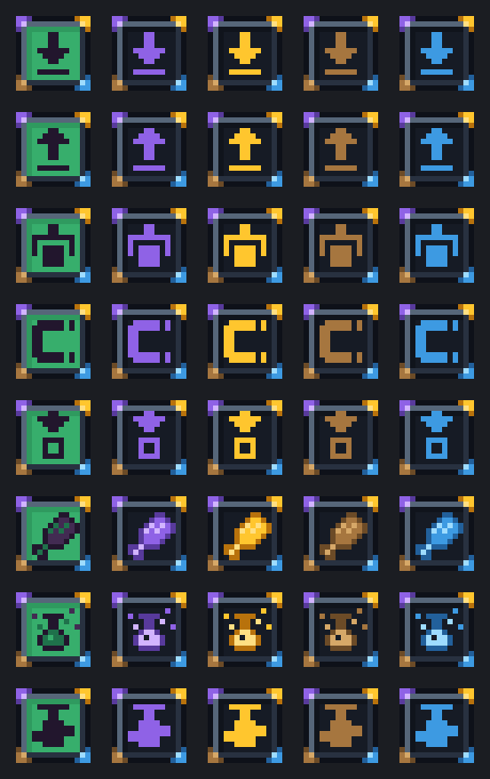
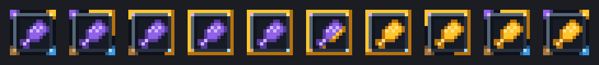

# Linha visual dos upgrades remotos

Guideline visual dos oito upgrades remotos, aprovada a partir do piloto do Feeding em 2026-10-31. Substitui o padrão de textura anterior de [P07](../UPGRADES.md#P07). Vale para o NeoForge 1.21.1 e o Forge 1.20.1.

## Princípios

- **O ícone é a identidade.** Cada upgrade preserva pixel a pixel o ícone central do seu sprite original (`design/upgrade-refresh/originals/`). Tudo fora dele é compartilhado.
- **Minimalismo.** As redes suportadas aparecem só em pequenos traços de cor. Nada de logos, texto ou ornamentos.
- **Estado legível no slot.** Em escala de GUI 1, deve dar para distinguir "sem vínculo" e "vinculado a quê" sem abrir tooltip.

## Anatomia (16×16)

| Região | Pixels | Conteúdo |
| --- | --- | --- |
| Aro | anel externo, `x/y = 1` e `14` | contorno `#0E1119` |
| Bisel | anel `x/y = 2` e `13` | ardósia: luz `#566679` em cima e à esquerda, sombra `#283140` embaixo e à direita, `#3A4656` nos dois cantos neutros |
| Tela | `x, y = 3..12` | área do ícone; a linha e a coluna 3 usam o tom de sombra da tela |
| Quinas | 3 pixels do aro + brilho no bisel, em cada canto | uma rede por canto |
| Ícone | pixels do original que não são o fundo `#37AE6C` | identidade do upgrade |

A margem de 1 px fora do aro continua transparente.

## Redes e cores

Cada rede tem três tons (claro, médio, escuro) e um canto fixo:

| Canto | Rede | Claro | Médio | Escuro |
| --- | --- | --- | --- | --- |
| Superior esquerdo | Applied Energistics 2 (fluix) | `#D2B4FF` | `#8F62E6` | `#583A9C` |
| Superior direito | Super Cool Calculator (dourado da marca SCC) | `#FFDF82` | `#FFC62E` | `#B8720C` |
| Inferior esquerdo | Tom's Simple Storage (carvalho) | `#D6A868` | `#A6763F` | `#6C4B27` |
| Inferior direito | Refined Storage (azul) | `#9EDCFF` | `#3D9AE2` | `#22609B` |

Desenho da quina: o pixel do canto e seus dois vizinhos no aro usam o tom médio; o terceiro pixel de cada braço, o escuro; o pixel diagonal no bisel, o claro. As quatro quinas aparecem em todos os estados.

## Estados

**Sem vínculo:** tela verde do remoto (`#37AE6C`, sombra `#2F9A5F`) e ícone nas cores originais.

**Vinculado:** tela escura (`#161B25`, sombra `#10141C`) e ícone na cor da rede. Mapeamento dos tons do ícone:

- Ícones com papéis distintos: contorno `#22162D` → escuro, preenchimento `#422B52` → médio, detalhe `#1F714B` → claro. É o caso do Feeding e do Alchemy.
- Silhuetas de um tom só (só `#22162D`): o tom médio. O escuro desapareceria sobre a tela escura. É o caso de Deposit, Restock, Pickup, Magnet, Refill e Pump.

## Animação de vínculo

Toca uma vez quando o jogador vincula o item com Shift + clique direito. Vale no slot, na mão e no mundo, e dura 1,08 s:

1. **Aro (380 ms, ease-in-out cúbico):** a cor da rede sai do canto dela e corre pelos dois lados até o canto oposto. Bordas de cima e da esquerda no tom médio; de baixo e da direita, no escuro.
2. **Tela (280 ms, ease-out cúbico):** duas frentes diagonais, do canto superior esquerdo e do inferior direito, avançam até o centro. Por onde passam, a tela assume o estado vinculado e o ícone, a cor da rede.
3. **Pausa (60 ms).**
4. **Recuo (360 ms, ease-in-out cúbico):** o aro se desfaz no sentido inverso e volta às quatro quinas.

**Troca de rede:** é a mesma sequência, partindo do sprite vinculado à rede anterior. A tela já está escura, então a diagonal só recolore o ícone.

Vincular de novo à mesma rede toca a sequência normalmente. Desvincular pela receita volta direto ao sprite sem vínculo, sem animação.

## Produção

- `design/upgrade-refresh/upgrade_visuals.py` implementa esta guideline para qualquer upgrade. A paleta e a moldura vêm de `gen_feeding.py`, e o percurso do aro, de `anim_feeding.py`.
- `design/upgrade-refresh/export_upgrades.py` grava nos recursos do NeoForge, que o Forge reutiliza no build, os sprites, os modelos e as faixas de animação dos oito upgrades.
- `design/upgrade-refresh/timeline.py` guarda os tempos e easings, espelhados em `LinkedUpgradeAppearance`. `render_60fps.py <upgrade> <rede> [rede anterior]` gera uma prévia de 60 fps.
- Um upgrade novo precisa só do sprite original 16×16 em `originals/`, com ícone sobre o fundo `#37AE6C`, e de uma entrada em `UPGRADES` no `upgrade_visuals.py`.

A implementação em jogo está descrita em [ARCHITECTURE.md](../ARCHITECTURE.md).
